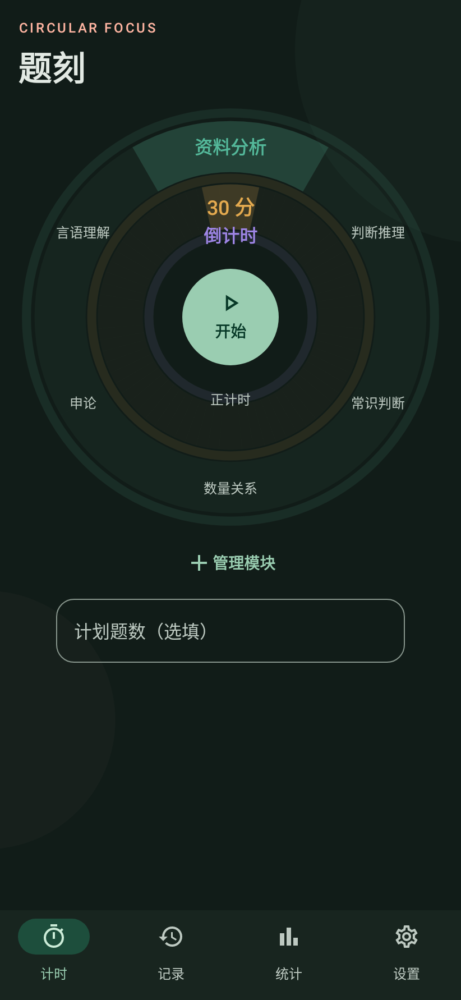
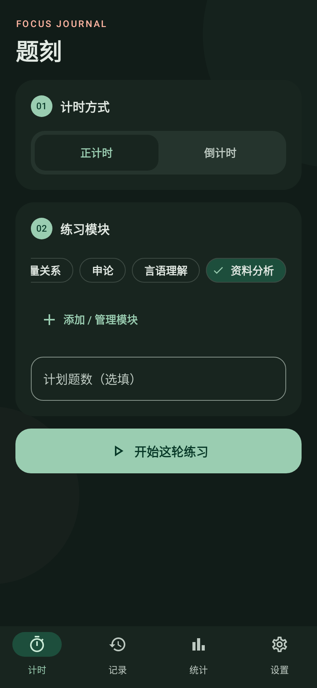
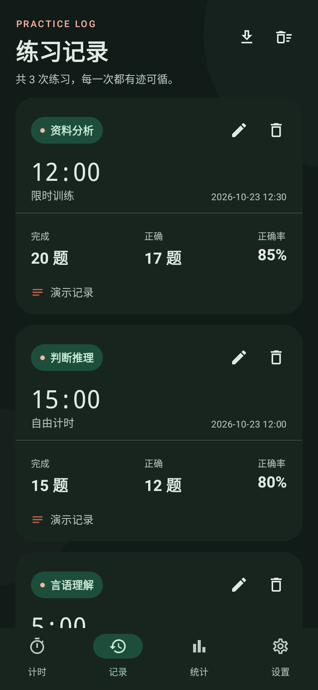
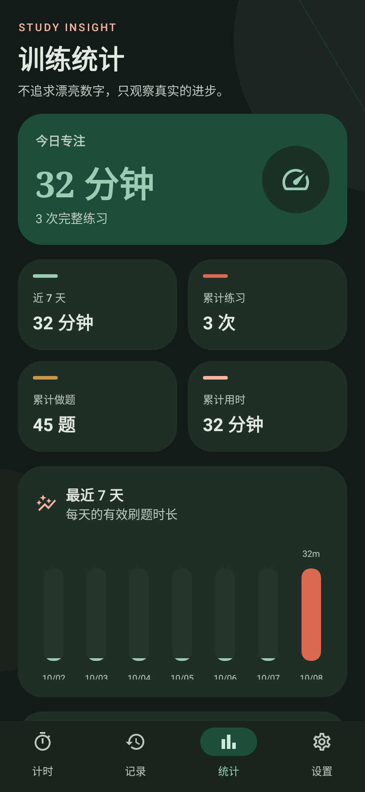
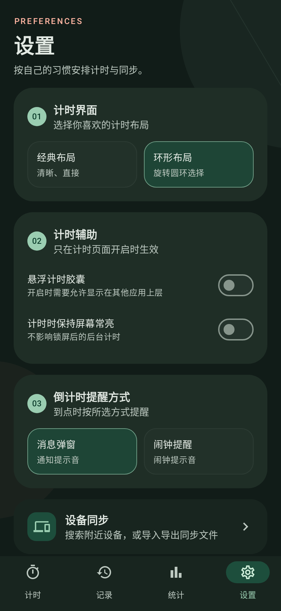
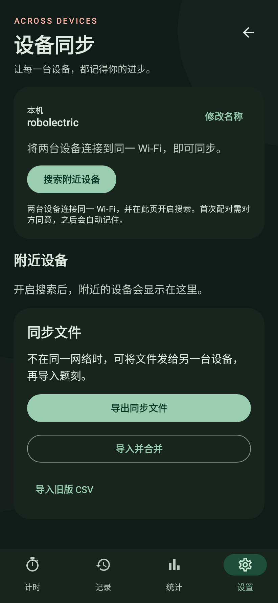
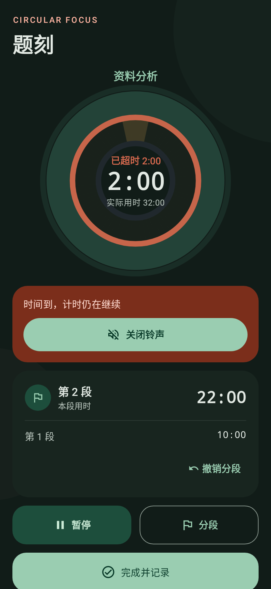
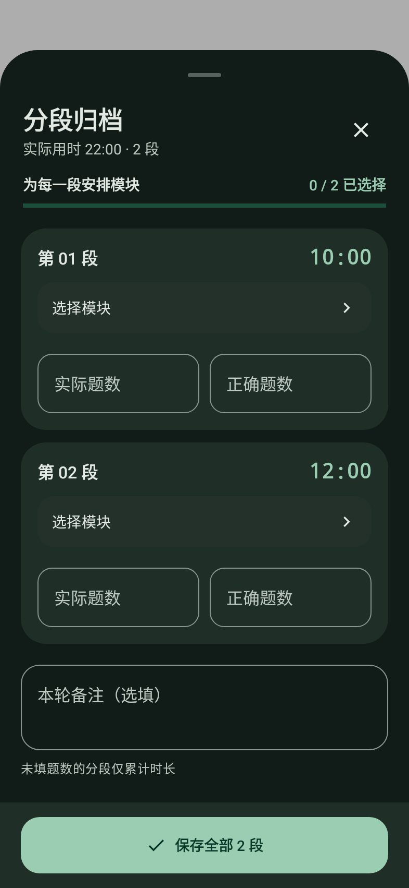
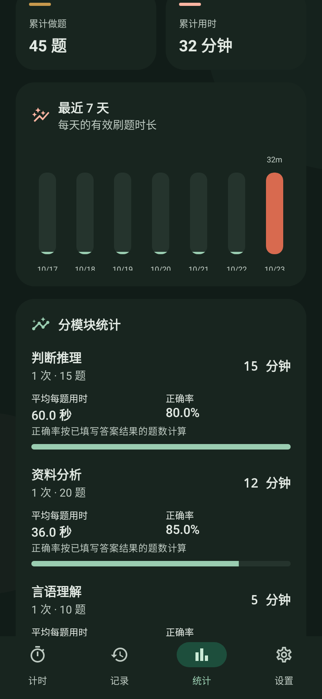

# 题刻 · Tike

一款用于刷题与专注训练的 Android 计时应用。记录实际用时、题数和正确率，按模块查看训练表现，支持同一局域网内的设备同步。无需注册账号。

**Android 8.0 及以上 · Kotlin / Jetpack Compose · 本地存储**

[下载安装包](https://github.com/YIT184/TiKe/releases/latest) · [更新记录](CHANGELOG.md)

## 页面预览

<table>
  <tr><th>环形计时</th><th>经典计时</th><th>练习记录</th></tr>
  <tr>
    <td></td>
    <td></td>
    <td></td>
  </tr>
  <tr><th>训练统计</th><th>设置与提醒方式</th><th>设备同步</th></tr>
  <tr>
    <td></td>
    <td></td>
    <td></td>
  </tr>
</table>

计时中分段，结束后逐段归档：

<table>
  <tr><th>计时中分段</th><th>结束后逐段归档</th></tr>
  <tr>
    <td></td>
    <td></td>
  </tr>
</table>

分模块查看平均每题用时与正确率：



## 功能

- **分段计时**：计时中点击“分段”开始下一段，暂停不计入时长；支持轻震反馈、查看各段用时和撤销上次分段。
- **逐段归档**：结束时为每段选择模块，可直接新建模块或沿用上一段；各段分别进入记录与模块统计，总用时不会重复累计。题数可留空，仅累计用时。
- **正计时与倒计时**：倒计时到点提醒后继续累计超时，手动结束时按实际用时保存。
- **两种计时界面**：经典布局与环形布局可在设置中切换。环形布局支持旋转或点击模块、模式；时间左右滑动，每格增减 5 分钟。
- **自定义倒计时**：双击圆环顶部的时间，输入任意 5–360 的整数分钟。
- **可选提醒方式**：消息弹窗使用通知提示音；闹钟提醒支持选择系统铃声或本地音频，声音选择会保存。到点后可在通知和计时页点击“关闭铃声”，计时继续累计超时。
- **自定义模块**：添加、保存和删除模块，删除模块不会清除历史记录；每个模块记住上次的计划题数。
- **练习复盘**：保存实际题数、正确题数和备注，可编辑、删除记录及导出 CSV。
- **分模块统计**：查看各模块的平均每题用时、正确率、练习量及用时趋势。
- **跨设备同步**：同一 Wi-Fi 或热点内搜索设备，双方同意后配对，保存配对信息；也支持 JSON 同步文件和旧版 CSV 导入。
- **计时辅助**：可选悬浮计时胶囊、屏幕常亮，支持深色模式。

## 安装与使用

1. 在 [发布](https://github.com/YIT184/TiKe/releases/latest) 下载最新 APK，在 Android 手机上安装。
2. 选择计时模式、模块及计划题数，点击“开始”。
3. 练习中可点击“分段”；完成后逐段选择模块，按需填写题数与备注，一次保存全部分段。
4. 在“记录”和“统计”查看训练情况，在“设置”调整布局、提醒方式和计时辅助。

倒计时提醒使用系统精确定时，并在暂停、继续时更新截止时间。请允许题刻发送通知；Android 12 如提示“闹钟和提醒”授权，允许后返回再次开始计时。声音、震动和弹出显示受系统通知通道及勿扰设置影响。

开启悬浮胶囊时，需要授予“显示在其他应用上层”权限。锁屏计时由常驻通知显示。部分系统的后台运行限制需要在系统设置中调整。HarmonyOS 原生实况窗是否显示还取决于设备系统及应用权益，普通计时通知可独立使用。

## 设备同步

入口：**设置 → 设备同步**。

两台设备连接同一 Wi-Fi 或热点后，搜索并选择对方，由对方同意配对。应用保存配对信息，后续可直接选择已配对设备同步。访客网络或开启设备隔离的网络可能阻止发现，此时可改用热点或同步文件。

JSON 文件可通过微信、蓝牙或网盘传给另一设备，再选择“导入并合并”。同步按记录标识合并，重复同步不会重复添加记录，编辑和删除状态也会参与合并。合并前会保留本机恢复副本。

分段的模块、顺序及用时随 JSON 同步文件一起保存。请使用 1.6.0 及以上版本互相同步以完整保留分段信息。闹铃音频和正在进行的分段计时保存在本机，不通过设备同步传输。

正在进行的计时、系统权限和本机设置不参与同步。同步文件包含练习记录和备注，请只分享给需要接收这些数据的设备。

## 从源码构建

需要 JDK 17 或兼容版本、Android SDK 34，以及 Gradle 构建所需的网络连接。推荐使用 Android Studio 打开项目并配置 SDK。

```powershell
git clone https://github.com/YIT184/TiKe.git
cd tike
.\gradlew.bat testDebugUnitTest lintDebug assembleDebug
```

Linux / macOS 可运行：

```bash
./gradlew testDebugUnitTest lintDebug assembleDebug
```

调试安装包输出到 `app/build/outputs/apk/debug/app-debug.apk`。

项目路径包含中文时，Windows 可使用 `build.ps1` 临时映射盘符后构建。签名文件、SDK、本地配置及构建缓存不会提交到仓库。没有维护者本地签名文件时使用 Android 默认调试签名；自行构建的安装包可能无法覆盖下载版，应用升级要求包名与签名一致。

可单独重新生成 README 截图：

```powershell
.\gradlew.bat testDebugUnitTest -PreadmeScreenshots --tests 'com.codex.shuatitimer.ReadmeScreenshotsTest'
```

## 数据与隐私

公开版本只预置模块类型，不预置个人练习记录。记录存储在本机 Room 数据库中；没有账号系统、遥测或云端数据服务。局域网同步在用户主动操作时进行，初次配对需双方同意，传输使用加密连接。

同步文件和 CSV 由用户选择保存及分享位置。卸载应用可能删除本机数据和内部恢复副本，重要记录请先导出备份。升级已有数据库会保留记录与模块。

## 技术栈

Kotlin · Jetpack Compose / Material 3 · Room · DataStore / SharedPreferences · Android NSD · JUnit / Robolectric / Compose UI Test

